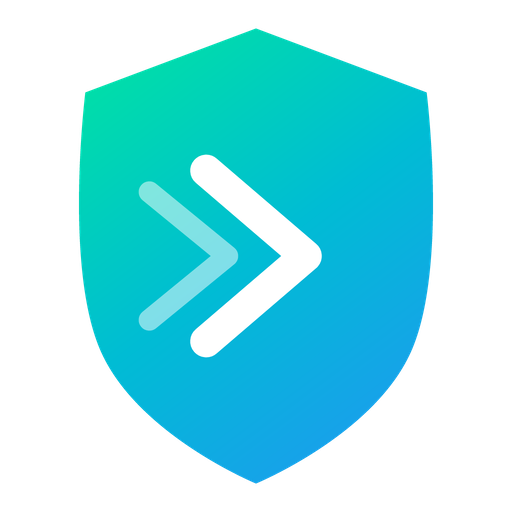
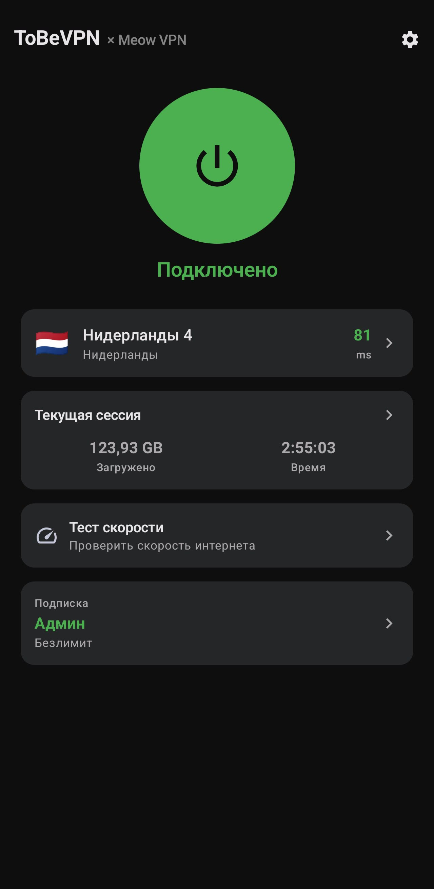
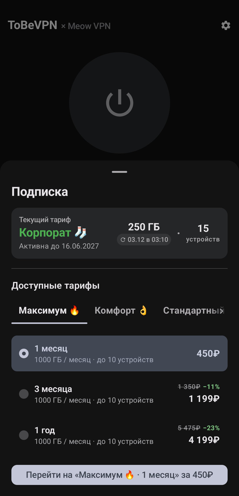
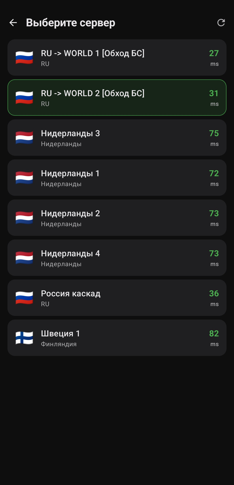
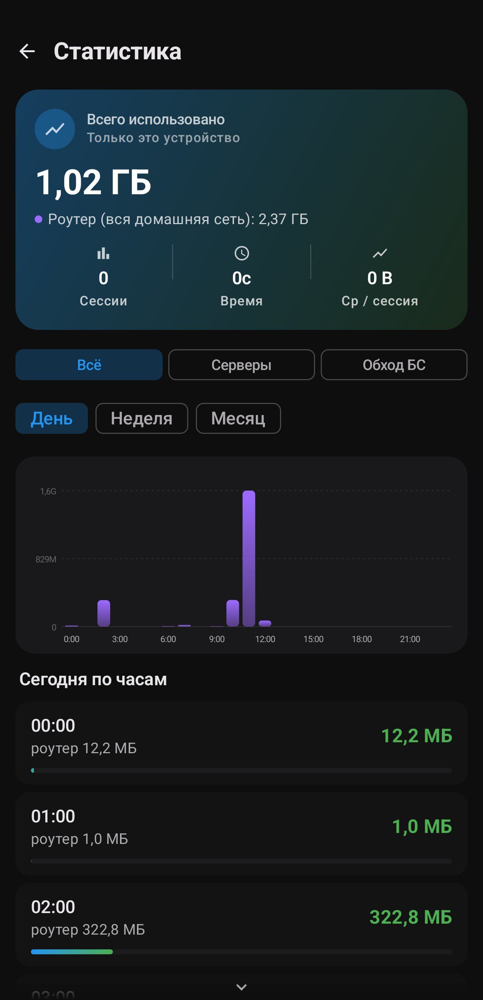
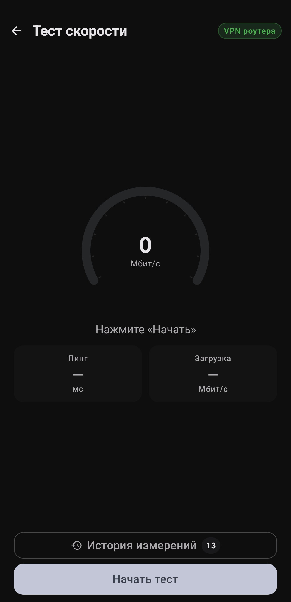
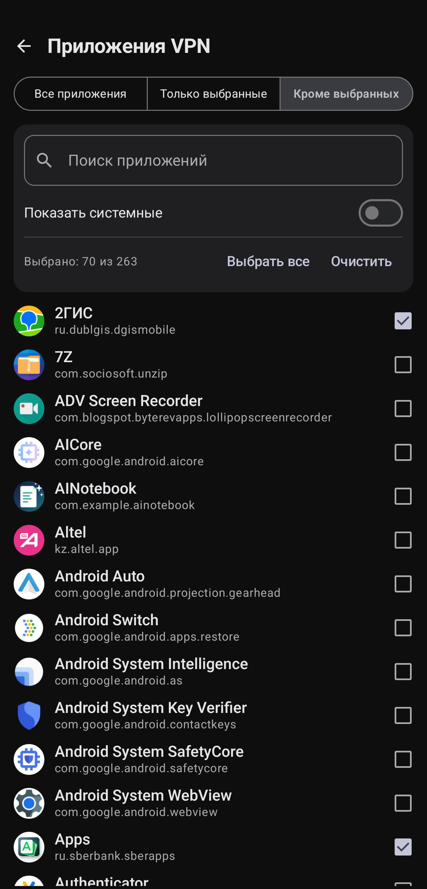

# ToBeVPN

**VPN-клиент для Android-смартфонов и планшетов: подписка, выбор серверов, VPN на домашнем роутере и встроенные обновления.**

---

## Что это

ToBeVPN — нативный Android-клиент к VPN-сети: подключение в одно нажатие, выбор приложений для VPN, установка VPN на домашний роутер прямо с телефона, статистика трафика и встроенные обновления.

## Главное

| | |
|--|--|
| 🛡️ **Защищённое подключение** | VLESS + REALITY и Hysteria2, проверка туннеля и автоматическое восстановление |
| 🌍 **Выбор сервера** | Список серверов с пингом и статусом, автоматический выбор лучшего |
| 📲 **Приложения для VPN** | Выбор приложений, которые идут через VPN или мимо него |
| 🏠 **VPN на роутере** | Установка на роутер с OpenWrt из приложения, свой сервер для каждого устройства, несколько роутеров; определение Keenetic |
| ⏸️ **Пауза в сети роутера** | Пришли в сеть роутера с VPN — VPN телефона на паузе, ушли — включается сам |
| 📈 **Статистика** | Трафик сессии, по дням и часам, вместе с трафиком роутера |
| 🚦 **Тест скорости** | Замер скорости с пометкой, идёт ли он через VPN телефона или роутера |
| ⚡ **Плитка быстрых настроек** | Включение VPN из шторки Android |
| 🔐 **Вход через Telegram** | Без пароля; email для восстановления, привязка устройства по QR или коду |
| 💳 **Подписка** | Тариф, срок, трафик, продление; промокоды и реферальная программа |
| 📺 **Подключение ТВ** | Привязка Android TV по QR-коду |
| 🎨 **Внешний вид** | Светлая и тёмная темы, RU / EN, масштаб интерфейса и текста |
| 🔁 **Перенос настроек** | Экспорт и импорт настроек с выбором, что сохранить |
| 🔄 **Встроенные обновления** | Проверка и установка новых версий внутри приложения |
| 🔒 **Шифрование данных** | Локальная БД зашифрована, ключ в Android Keystore |
| 🛟 **Резервный маршрут** | При недоступности основного бэкенда — автоматический повтор через резервный |

## Скриншоты

  <table>
    <tr>
      <td align="center"><b>Главный экран</b></td>
      <td align="center"><b>Подписка</b></td>
      <td align="center"><b>Серверы</b></td>
    </tr>
    <tr>
      <td></td>
      <td></td>
      <td></td>
    </tr>
    <tr>
      <td align="center"><b>Статистика</b></td>
      <td align="center"><b>Тест скорости</b></td>
      <td align="center"><b>Приложения VPN</b></td>
    </tr>
    <tr>
      <td></td>
      <td></td>
      <td></td>
    </tr>
  </table>

## Безопасность

- Локальная БД зашифрована, ключ хранится в аппаратном Android Keystore.
- Чувствительные данные (токены, ключ подписки, email) исключены из резервного копирования.
- Backend-хосты не хранятся в исходниках — подставляются при сборке.
- Авторизация без долгоживущих токенов на устройстве.

## Связанные репозитории

- **Desktop-клиент:** [ToBeVPN-Desktop](https://github.com/Shoolife/ToBeVPN-Desktop) — Linux / Windows
- **Android TV-клиент:** [ToBeVPN-TV](https://github.com/Shoolife/ToBeVPN-TV) — Android TV / приставки и LG webOS
- *(планируется)* iOS-клиент

## Roadmap

- [ ] Установка VPN на роутеры Keenetic
- [ ] iOS-клиент
- [ ] Виджет быстрого подключения для launcher
- [ ] Статистика трафика по приложениям

## Contributing

Issue welcome. PR — лучше предварительно обсудить через issue. Коммиты — present tense, conventional commits не обязательны но приветствуются.

## Лицензия

Проприетарное приложение. Исходный код предоставляется для прозрачности и self-host'инга — коммерческое использование/перепродажа запрещены.

---

  Сделано с ❤️ командой <b>ToBeVPN × Meow VPN</b>

